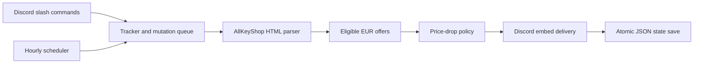

# Game price alerts for Discord

A small TypeScript bot that brings game-price tracking into a Discord channel. Follow a game with a slash command, get hourly price updates, and receive an `@everyone` mention when a reduction is large enough to matter.

Rather than mentioning everyone on every fluctuation, it compares prices against a saved reference: small drops accumulate, repeated deals produce updates without another mention, and returning sales can qualify again after a sustained recovery. Offer filtering excludes unsuitable platforms, editions, regions, accounts, gifts, and cashback.

**Stack:** Node.js native TypeScript execution · discord.js · JSON file persistence · Node test runner. No database, build step, or privileged Discord intents.

## Try it without Discord

```sh
npm ci
npm run demo
npm test
```

Requires **Node.js 24.12 or newer**. The demo uses the actual pricing and notification modules with invented data. It prints a sequence of price decisions and a sample Discord payload; it does not read `.env`, fetch prices, connect to Discord, or create tracking data.

An alert looks like this (illustrative text, **not a live offer or Discord screenshot**):

> @everyone
>
> **Example game — price dropped**
>
> €25.00 → **€19.99**
>
> Save €5.01 (20%).
>
> **Edition:** Standard · **Store:** Example Store
>
> Prices via AllKeyShop • Advertised EUR price; confirm the final total at checkout.

For a €25.00 reference, €24.00 and €23.00 produce routine updates. €22.50 reaches both default thresholds and triggers an alert; that becomes the new reference. A repeated €22.50 offer produces an update without another mention.

## How it works



The source adapter parses embedded JSON without executing page scripts. Money is represented as integer cents. The pure pricing policy is separate from fetching and delivery, so price histories can be exercised offline. A single-writer lock and serialized mutations protect the combined product/state store; state is committed only after successful delivery so failed messages can be retried.

This is a personal, single-server tool with France-compatible EUR offer rules, not a general price comparison service. There is no web dashboard, multi-server hosting, or historical price chart. The [development notes](#development) describe tests and remaining tradeoffs.

## Setup

Requires **Node.js 24.12 or newer**. Run `npm ci`. TypeScript runs directly; there is no build step.

1. Copy `.env.example` to `.env` if it does not already exist.
2. Create an application in the [Discord Developer Portal](https://discord.com/developers/applications). Obtain its bot token and set `DISCORD_BOT_TOKEN` in `.env`.
3. Invite the bot with the `bot` and `applications.commands` scopes and **View Channels**, **Send Messages**, and **Embed Links**, and **Mention @everyone, @here, and All Roles** permissions. Administrator and privileged intents are unnecessary.
4. Enable Discord Developer Mode, copy your chosen alert channel's ID, and set `DISCORD_CHANNEL_ID` in `.env`. The bot derives the server from this channel. Channel overrides must also permit viewing, sending, embeds, and mentioning everyone.
5. Run `npm start`. Wait for `/games commands are ready`. The bot posts an online message in the alert channel on each successful startup. Checking starts immediately, then waits the configured interval between runs.

Run **one bot process** per data directory. Keep the computer and process running. Ctrl+C requests a clean shutdown.

## Windows automatic startup

Run `powershell -NoProfile -ExecutionPolicy Bypass -File .\install-startup.ps1` once to install a shortcut in your Windows Startup folder. The bot then starts hidden whenever you sign in, using this folder's `.env` and `tracker.json`. Keep this project folder in place; rerun the installer if you move it.

The launcher avoids duplicate launches, recovers stale locks after reboot or a dead owner process, and retries failed bot runs every 60 seconds (including when the internet is not ready yet). A normal exit is not restarted. An existing process holding the tracker lock is left running. Logs are in `bot.log`, `bot-error.log`, and `startup.log`; the previous bot run's logs are retained as `previous-bot.log` and `previous-bot-error.log`.

To disable future automatic starts, run `powershell -NoProfile -ExecutionPolicy Bypass -File .\install-startup.ps1 -Remove`. This does not stop an already running bot. The bot cannot check prices while the PC is asleep or shut down.

## Commands

Commands work in the configured channel's server for members with **Manage Server** permission. Replies are private; price alerts go to the configured channel.

| Command | Result |
| --- | --- |
| `/games add url:<URL> name:<optional> edition:<optional>` | Follow a product without fetching prices. |
| `/games list` | Show products, IDs, saved prices, alert reference prices, and last successful checks. |
| `/games remove id:<ID>` | Remove the product and its saved price state. |
| `/games check` | Check prices, save observations, and send qualifying alerts. |
| `/games check dry-run:true` | Preview without saving or sending. |

Use English AllKeyShop comparison URLs, such as `https://www.allkeyshop.com/blog/buy-elden-ring-cd-key-compare-prices/`. Steam defaults to Standard edition; specify the page's edition label, such as Deluxe, to track another edition separately. WoW game-time prepaid links are recognized automatically. Other prepaid products, Steam store URLs, and individual seller links are unsupported.

The first successful regular check establishes a baseline and posts the current price. Products without one show **Awaiting first successful check**. `/games list` reads saved observations, with check times in GMT (UTC); failed checks and previews do not update them. The alert reference price can differ from the latest saved price.

Add, remove, and check run one at a time. Lists remain available during other commands. Steam results and alerts identify the edition. Long replies arrive as text attachments.

## Prices and alerts

- A drop must meet **both 10% and €2** by default. Small reductions accumulate against the initial or last alerted price; unchanged deals receive routine price updates without a mention.
- Returning sales can alert after higher prices have been observed over **48 hours**. Short spikes do not reset the reference. A gap longer than two check intervals restarts that recovery period, so downtime does not count as evidence.
- Prices use individual offers' listed card-payment totals, including reported fees and coupon discounts. Cashback is excluded. Confirm the final total at the store.
- Steam offers must be in-stock keys for the chosen edition and listed global/EU/Europe/EMEA/France regions. Accounts, gifts, unknown restrictions, and other platforms are excluded. WoW game-time offers must be compatible with France.
- Source or delivery failures preserve the previous state. A later check retries if the price still qualifies; expired deals are not queued. Successful progress is saved per product.

## Settings and data

`tracker.json` is the only active store. It contains settings, followed products, and each product's current/reference price and recovery timestamps, rather than a chronological price log. Stop the bot before editing settings; manage products through commands so IDs and saved state stay consistent.

| Setting | Default | Meaning |
| --- | --- | --- |
| `minimumDropPercent` | `10` | Minimum percentage saving. |
| `minimumDropEuro` | `2` | Minimum EUR saving; both thresholds must pass. |
| `checkIntervalMinutes` | `60` | Wait between checks; range 1–35,791 minutes. |
| `resetAfterHours` | `48` | Required duration of sustained higher observations. |

Back up `tracker.json` and keep a private backup of `.env`. `TRACKER_DATA_DIR` selects another data directory. Retained files under `backups/` are private credential and tracking-data snapshots, never runtime inputs.

The bot holds `.tracker.lock` for its lifetime. **Never delete it while a bot process is running.** Clean shutdown finishes the current operation and releases it; network timeouts can delay shutdown. After a crash, stop all bot processes before removing a stale lock. Storage failures stop the bot to avoid continuing with unsaved state.

Git tracks source, tests, fixtures, configuration templates, and documentation. Credentials, live data, logs, locks, installed dependencies, and backups are ignored. Git does not replace private data backups.

## Development

- `demo.ts`: credential-free examples using the real pricing and notification modules.
- `bot.ts`: Discord connection, permissions, commands, and lifecycle.
- `tracker.ts`: product management, checks, scheduling, and JSON persistence.
- `pricing.ts`: pure price-drop and returning-sale decisions.
- `sources.ts`: AllKeyShop requests, parsing, and offer eligibility.
- `notifications.ts`: Discord alert formatting.

One process owns one combined store. A mutation queue prevents commands and checks from racing; a lifetime lock prevents a second writer. Atomic file replacement keeps products and price state together. Alerts use the bot's existing Discord connection.

Run `npm test` for type checking and offline tests, or `npm run typecheck` alone. Tests use temporary stores and mocked Discord/network calls. The two HTML fixtures contain trimmed WoW 60-day and Elden Ring offer data captured on **2026-09-27**, with source URLs in `sources.test.ts`. Tests modify these rows to exercise unsuitable offers; fixture prices are not current quotations. Real Discord setup still needs live verification.

Fixture provenance is recorded in [fixtures/README.md](fixtures/README.md). Dependency packages retain their own license notices; this repository does not currently declare a source-code license.

AllKeyShop's embedded data is undocumented and can change or be blocked. Missing or unsuitable prices produce errors; zero-price placeholders are ignored. A successful Discord send followed by a crash before saving can occasionally cause a duplicate alert after restart.
